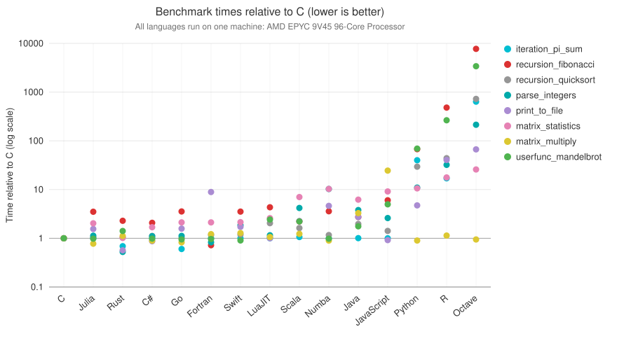

@def description = "Julia micro-benchmarks comparing Julia with C, Fortran, Python, Numba, R, Java, Scala, JavaScript, Go, Rust, Swift, LuaJIT and Octave on common code patterns."
# Julia Micro-Benchmarks

These micro-benchmarks, while not comprehensive, do test compiler performance on a range of common code patterns, such as function calls, string parsing, sorting, numerical loops, random number generation, recursion, and array operations.

The results below were taken from the [Microbenchmarks site](https://julialang.github.io/Microbenchmarks/dev/benchmarks/), which is regenerated automatically and always has the most up to date numbers.

It is important to note that the benchmark codes are not written for absolute maximal performance (the fastest code to compute `recursion_fibonacci(20)` is the constant literal `6765`). Instead, the benchmarks are written to test the performance of identical algorithms and code patterns implemented in each language. For example, the Fibonacci benchmarks all use the same (inefficient) doubly-recursive algorithm, and the pi summation benchmarks use the same for-loop. The “algorithm” for matrix multiplication is to call the most obvious built-in/standard random-number and matmul routines (or to directly call BLAS if the language does not provide a high-level matmul), except where a matmul/BLAS call is not possible (such as in JavaScript).

For the exact timings and the versions of each language, see the [Microbenchmarks site](https://julialang.github.io/Microbenchmarks/dev/benchmarks/).

Note that the Julia results depicted above do not include compile time.

The vertical axis shows each benchmark time normalized against the C implementation (log scale, lower is better), with one dot per benchmark and language. The languages compared are C, Julia, Rust, C#, Go, Fortran, Swift, LuaJIT, Scala, Numba, Java, JavaScript, Python, R and Octave. For the methodology and limitations, see the [Microbenchmarks methodology](https://julialang.github.io/Microbenchmarks/dev/#Methodology).

All languages were run on the same GitHub Actions runner (the CPU is named in the chart), in single-threaded mode. Each benchmark is run 5 times in-process and the minimum time is kept; the whole suite is run 3 times and the best of the up to 15 measurements is reported. Julia and Numba perform a warm-up pass first so that compilation time is excluded.

## Other Relevant Benchmarks

- Graphs: [https://www.timlrx.com/blog/benchmark-of-popular-graph-network-packages-v2](https://web.archive.org/web/20230603153205/https://www.timlrx.com/blog/benchmark-of-popular-graph-network-packages-v2)
- CSV and Pandas: [https://www.queryverse.org/benchmarks/](https://www.queryverse.org/benchmarks/)
