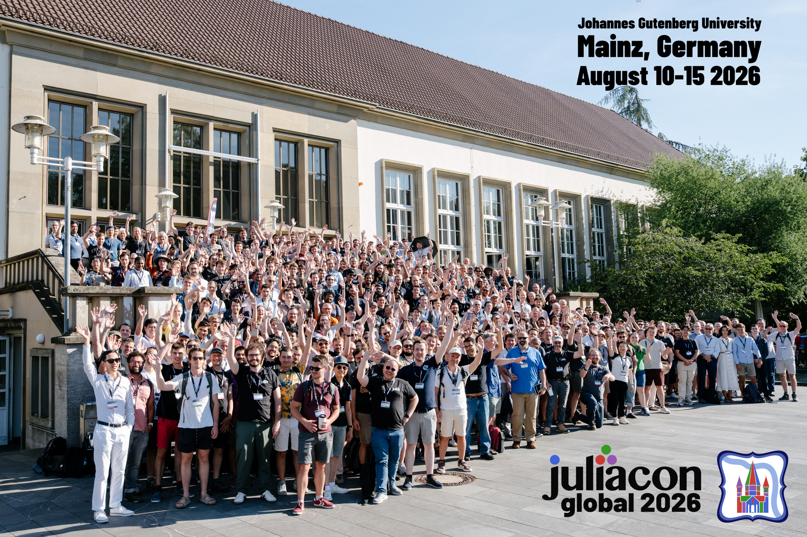
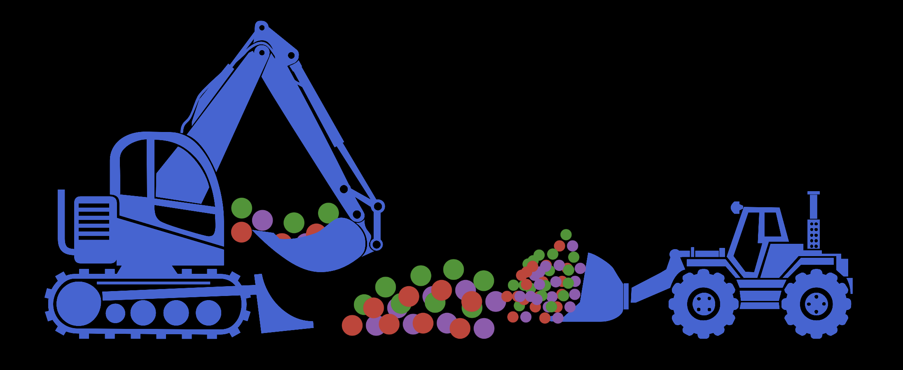

@def title = "JuliaCon Global 2027 Tallinn Announced and JuliaCon Global 2026 Mainz Wrap-Up"
@def authors = "JuliaCon Global Organizing Committee"
@def published = "9 November 2026"
@def rss_pubdate = Date(2026, 11, 9)
@def rss_description = """JuliaCon Global 2027 Tallinn Announced and JuliaCon Global 2026 Mainz Wrap-Up Blogpost."""

## JuliaCon Global 2027 in Tallinn announced

We’re happy to announce that **JuliaCon Global 2027** will be held at [Tallinn University of Technology (TalTech)](https://taltech.ee/en/) in **Tallinn, Estonia, August 9-14, 2027**! This is the first time JuliaCon ventures into the Baltic-Nordic region. Follow the up-to-date news on the [JuliaCon Global 2027 official website](https://juliacon.org/2027/).

### Key Dates for JuliaCon Global 2027

- **Call for Minisymposia Proposals** opens from Nov 15, 2026 to Jan 15, 2027.
- **Call for Workshop Proposals** opens shortly after mini cfp closes.
- **Main Call for Proposals** opens in early February 2027 after we reviewed and accepted minis, and opens for 2 months.

- Early-bird tickets will go on sale at the beginning of 2027, full-price ticket sales will start when the full schedule is released.

We look forward to seeing you in Tallinn, and please keep an eye out for future announcements!

## JuliaCon Global 2026 Mainz Wrap Up

JuliaCon Global 2026 in Mainz was a wonderful, record breaking event for our community: **461 attendees from 30 countries, with 19 minisymposia, 280 sessions, and 90 posters hosted!** We have 22 sponsors from industry, academia, public, and non-profit sectors, many of whom have been supporting JuliaCon and JuliaLang for years. 

We sincerely thank all the sponsors who made JuliaCon Global 2026 not only successful but also accessible for our passionate communities around the world. With their support, we were able to fund more than 20 scholarships, empowering recipients to travel across continents from countries like Argentina, Brazil, Australia, India, Japan, China, and the United States.

Special thanks to the local members of the Johannes Gutenberg-Universität Mainz, especially **Brigitte Burkert** and **Mariana Cosarinsky**. They have been working incredibly hard for months to ensure the smooth operation of all aspects of this year's JuliaCon. We also thank the catering and AV teams for their attentive service. This event also could not have been successful without the help of all our amazing volunteers. Thank you!

JuliaCon Global 2026 Mainz Videos are now available on [the Julia Programming Language YouTube channel](https://youtube.com/playlist?list=PLPHnI5tK4C10&si=_-UwcpU3K6xwTunx).

### Julia Community Prizes 2026

We want to be sure you didn’t miss the Julia Community Prizes. These prizes were announced at the closing ceremony. The awardees this year were:

#### **Penelope Yong**
For her contributions to Turing.jl and JuliaFormatter.

#### **Andreas Noack, Daniel Karrasch, and Jishnu Bhattacharya**
For their efforts maintaining the Julia Linear Algebra library.

Awardees are nominated by the Julia community, and then winners are selected by a committee of senior community members based on their holistic contributions across the ecosystem.

## JuliaCon Global 2026 Proceedings

The [Editorial Board](https://proceedings.juliacon.org/about#editorial_board) of the [Proceedings of the JuliaCon Conferences](https://proceedings.juliacon.org) is happy to announce that **submissions for 2026 contributions are now open**!

If you presented a talk, poster or workshop at **JuliaCon Global 2026 in Mainz**, you are welcome to submit a paper about your work. The submission form and all details are on [proceedings.juliacon.org](https://proceedings.juliacon.org). The [author guide](https://juliacon.github.io/proceedings-guide/) explains how to prepare your paper with the JuliaCon template and what to expect during review.

:date: **Submissions are open until the end of March 2027.**

Reviews happen openly on GitHub. You can speed up the process by suggesting reviewers who could review your work when you submit.

**The Editorial Board is also looking for reviewers!** If you'd like to help, please leave your GitHub handle and areas of expertise in [this form](https://forms.gle/SXDiZ2PZFW16aZAN8). Reviewing is a great way to contribute to the community and to see how others use Julia.

